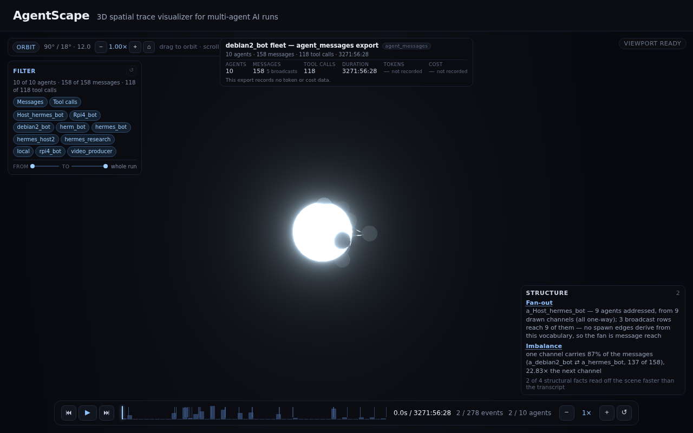

# AgentScape — the spatial-insight criterion, demonstrated (M5-T4)

Generated 2026-10-30 from the committed fixtures and the real `debian2_bot` export.

## The claim

PRD §7 makes one metric load-bearing: **the scene must surface at least two structural facts faster than a timeline does** on the reference run, from the candidates — total fan-out per agent, an unbounded/looping sub-agent, message-volume imbalance, cost concentration. If it cannot be demonstrated, the project ships as a demo and is reported as such.

A flat timeline answers *what happened, in order?* It cannot answer *what shape is this?* without the reader reconstructing the shape by eye: a fan-out is only visible as a set of rows that share a sender, a loop only as a repeated direction across time, and dominance only as a total nobody computed. The scene encodes those quantities directly — node radius and glow carry activity, arc width carries volume, arc animation carries the net direction — so the answer is read off a mark instead of aggregated out of a stream.

## How the comparison is measured

A human stopwatch is not available to an automated run, so the claim is measured as **reader work, counted**:

- the **timeline path** must read every message row (a fan-out can hide in the last row), hold one counter per key while aggregating, and then compare;
- the **scene path** reads **one mark**, because the mapping already did the aggregation;
- a fact counts as `spatial-faster` when the transcript costs at least 4 rows per scene mark. Below that the stream is short enough that scanning it is not the bottleneck, and the honest verdict is `too-small`;
- a fact the run cannot answer, or that v1 draws no channel for, is `not-drawn` and can never count towards the criterion.

This is auditable but it is not a stopwatch: it bounds *what must be read*, not *how long a person takes*. The PRD’s `< 60 s` time-to-first-insight metric needs a person in front of the scene, and that is the human-held review loop (M5-T5) — no verdict for it is recorded here.

## Result

Criterion requires **2 facts** surfaced faster than the transcript.

| run | agents | messages | facts faster | verdict | tally |
|---|---|---|---|---|---|
| fixture: Fan-out (reference) | 6 | 5 | Fan-out, Imbalance | **met** | 2 faster · 2 not drawn |
| fixture: Loop (reference) | 3 | 7 | Loop, Imbalance | **met** | 2 faster · 2 not drawn |
| fixture: Dead branch | 3 | 3 | none | not met | 2 too small · 2 not drawn |
| fixture: Handoff chain | 4 | 3 | none | not met | 4 not drawn |
| debian2_bot fleet — agent_messages export | 10 | 158 | Fan-out, Imbalance | **met** | 2 faster · 2 not drawn |

**The criterion holds on 2 of 2 reference runs** (fixture: Fan-out, fixture: Loop): each surfaces at least 2 of the four candidate facts with a single mark per fact.

## The comparison, run by run

### fixture: Fan-out

`run_619a61f6` · 6 agents · 5 message rows · 5 channels · 5 spawn / 0 handoff / 0 message edges

| fact | verdict | timeline path | scene path | answer |
|---|---|---|---|---|
| Fan-out | spatial-faster (5×) | 5 rows · 1 key · aggregate | 1 mark · one node's incident arc fan, with the net direction animating away (M3-T2) | a_orchestrator — 5 agents put to work, from 5 drawn channels (all one-way) |
| Loop | not-drawn | 5 rows · 5 keys · aggregate | no mark · the heaviest two-way arc, drawn from both ends with no net flow to animate (M3-T2) | No loop: no pair exchanges messages in both directions. |
| Imbalance | spatial-faster (5×) | 5 rows · 1 key · aggregate | 1 mark · node radius and glow (activity, M2-T3/M3-T4) and arc width (volume) | a_orchestrator carries 67% of the run’s activity (10 of 15), 10× the next agent |
| Cost | not-drawn | 5 rows · 6 keys · aggregate | no mark · nothing — v1 draws no cost channel (PRD §4.2 keeps a cost heat overlay post-MVP) | Not recorded: this export carries no token or cost column, so no agent can be charged. |

- Loop: No pair exchanges messages in both directions.
- Cost: The export records no cost figures (the adapter sets them to 0), and v1 draws no cost channel — PRD §4.2 lists a cost heat overlay as post-MVP.

### fixture: Loop

`run_e55bfefa` · 3 agents · 7 message rows · 2 channels · 1 spawn / 0 handoff / 2 message edges

| fact | verdict | timeline path | scene path | answer |
|---|---|---|---|---|
| Fan-out | not-drawn | 7 rows · 3 keys · aggregate | no mark · one node's incident arc fan, with the net direction animating away (M3-T2) | No agent fans out: every agent addresses at most one other. |
| Loop | spatial-faster (7×) | 7 rows · 2 keys · aggregate | 1 mark · the heaviest two-way arc, drawn from both ends with no net flow to animate (M3-T2) | a_critic ⇄ a_researcher — 3 turns each way (3→ / 3←, 100% symmetric); the run ends inside the loop |
| Imbalance | spatial-faster (7×) | 7 rows · 2 keys · aggregate | 1 mark · node radius and glow (activity, M2-T3/M3-T4) and arc width (volume) | one channel carries 86% of the messages (a_critic ⇄ a_researcher, 6 of 7), 6× the next channel |
| Cost | not-drawn | 7 rows · 3 keys · aggregate | no mark · nothing — v1 draws no cost channel (PRD §4.2 keeps a cost heat overlay post-MVP) | Not recorded: this export carries no token or cost column, so no agent can be charged. |

- Fan-out: No agent fans out on this run: the widest spawn is 1 child.
- Cost: The export records no cost figures (the adapter sets them to 0), and v1 draws no cost channel — PRD §4.2 lists a cost heat overlay as post-MVP.
- Concentration is a *channel* fact, not an agent one: the busiest channel carries 6 of 7 messages (86%), 6× the next. A per-agent ranking would have shown a tie.

### fixture: Dead branch

`run_09ca3555` · 3 agents · 3 message rows · 2 channels · 2 spawn / 0 handoff / 1 message edges

| fact | verdict | timeline path | scene path | answer |
|---|---|---|---|---|
| Fan-out | too-small | 3 rows · 2 keys · aggregate | 1 mark · one node's incident arc fan, with the net direction animating away (M3-T2) | a_orchestrator — 2 agents put to work, from 2 drawn channels (0 net-in, 1 balanced) |
| Loop | not-drawn | 3 rows · 2 keys · aggregate | no mark · the heaviest two-way arc, drawn from both ends with no net flow to animate (M3-T2) | No loop: 1 pair exchange once each way — a request and its reply — and nothing repeats. |
| Imbalance | too-small | 3 rows · 2 keys · aggregate | 1 mark · node radius and glow (activity, M2-T3/M3-T4) and arc width (volume) | one channel carries 67% of the messages (a_orchestrator ⇄ a_worker_ok, 2 of 3), 2× the next channel |
| Cost | not-drawn | 3 rows · 3 keys · aggregate | no mark · nothing — v1 draws no cost channel (PRD §4.2 keeps a cost heat overlay post-MVP) | Not recorded: this export carries no token or cost column, so no agent can be charged. |

- Loop: 1 pair reciprocate once each way; a loop needs 2 turns.
- Cost: The export records no cost figures (the adapter sets them to 0), and v1 draws no cost channel — PRD §4.2 lists a cost heat overlay as post-MVP.
- Fan-out and Imbalance: the transcript is only 3 rows — below the 4 rows per mark a saving has to clear.
- This run is the criterion’s **negative control**: every candidate is either too small to clear 4 rows per mark or not present at all, so the criterion correctly fails here. A report that passed on every run would prove nothing.
- Fewer than 2 facts clear the 4× rows-per-mark bar on this run: it is too small (or too evenly shaped) to demonstrate the criterion.

### fixture: Handoff chain

`run_d54af06d` · 4 agents · 3 message rows · 3 channels · 0 spawn / 3 handoff / 0 message edges

| fact | verdict | timeline path | scene path | answer |
|---|---|---|---|---|
| Fan-out | not-drawn | 3 rows · 3 keys · aggregate | no mark · one node's incident arc fan, with the net direction animating away (M3-T2) | No agent fans out: every agent addresses at most one other. |
| Loop | not-drawn | 3 rows · 3 keys · aggregate | no mark · the heaviest two-way arc, drawn from both ends with no net flow to animate (M3-T2) | No loop: no pair exchanges messages in both directions. |
| Imbalance | not-drawn | 3 rows · 3 keys · aggregate | no mark · node radius and glow (activity, M2-T3/M3-T4) and arc width (volume) | No concentration: traffic is spread evenly across agents and channels. |
| Cost | not-drawn | 3 rows · 4 keys · aggregate | no mark · nothing — v1 draws no cost channel (PRD §4.2 keeps a cost heat overlay post-MVP) | Not recorded: this export carries no token or cost column, so no agent can be charged. |

- Fan-out: No agent fans out on this run: the widest message reach is 1 agent.
- Loop: No pair exchanges messages in both directions.
- Imbalance: No agent or channel clears 2× the next one (agents 1×, channels 1×).
- Cost: The export records no cost figures (the adapter sets them to 0), and v1 draws no cost channel — PRD §4.2 lists a cost heat overlay as post-MVP.
- This run is the criterion’s **negative control**: every candidate is either too small to clear 4 rows per mark or not present at all, so the criterion correctly fails here. A report that passed on every run would prove nothing.
- Fewer than 2 facts clear the 4× rows-per-mark bar on this run: it is too small (or too evenly shaped) to demonstrate the criterion.

### debian2_bot fleet — agent_messages export

`run_a4afe631` · 10 agents · 158 message rows · 26 channels · 0 spawn / 0 handoff / 33 message edges

| fact | verdict | timeline path | scene path | answer |
|---|---|---|---|---|
| Fan-out | spatial-faster (158×) | 158 rows · 7 keys · aggregate | 1 mark · one node's incident arc fan, with the net direction animating away (M3-T2) | a_Host_hermes_bot — 9 agents addressed, from 9 drawn channels (all one-way); 3 broadcast rows reach 9 of them — message reach, not a derived hierarchy (no spawn edges) |
| Loop | not-drawn | 158 rows · 26 keys · aggregate | no mark · the heaviest two-way arc, drawn from both ends with no net flow to animate (M3-T2) | No loop: the busiest two-way channel, a_debian2_bot ⇄ a_hermes_bot, is asymmetric (34→ / 103←, 50% symmetric) — a hub relationship, not a loop |
| Imbalance | spatial-faster (158×) | 158 rows · 26 keys · aggregate | 1 mark · node radius and glow (activity, M2-T3/M3-T4) and arc width (volume) | one channel carries 87% of the messages (a_debian2_bot ⇄ a_hermes_bot, 137 of 158), 22.83× the next channel |
| Cost | not-drawn | 158 rows · 10 keys · aggregate | no mark · nothing — v1 draws no cost channel (PRD §4.2 keeps a cost heat overlay post-MVP) | Not recorded: this export carries no token or cost column, so no agent can be charged. |

- Loop: No symmetric repeated exchange (busiest two-way channel is 50% symmetric; a loop needs 80%).
- Cost: The export records no cost figures (the adapter sets them to 0), and v1 draws no cost channel — PRD §4.2 lists a cost heat overlay as post-MVP.
- The widest fan is partly a shout: 3 broadcast rows from `a_Host_hermes_bot` reach 9 agents, while only 2 are addressed by a directed message. The scene draws the broadcast as a spoke to each — honest, and easy to misread as that many decisions.
- Concentration is a *channel* fact, not an agent one: the busiest channel carries 137 of 158 messages (87%), 22.83× the next. A per-agent ranking would have shown a tie.
- The loop detector rejected the busiest two-way channel: `a_debian2_bot` ⇄ `a_hermes_bot` runs 34→ / 103← (50% symmetric), which is a hub relationship, not a runaway.

## What each candidate turns into on screen

- **Fan-out** — one node's incident arc fan, with the net direction animating away (M3-T2). On the timeline: 5 rows and 1 key, aggregated by hand. Demonstrated on 2 runs.
- **Loop** — the heaviest two-way arc, drawn from both ends with no net flow to animate (M3-T2). On the timeline: 7 rows and 2 keys, aggregated by hand. Demonstrated on 1 run.
- **Imbalance** — node radius and glow (activity, M2-T3/M3-T4) and arc width (volume). On the timeline: 5 rows and 1 key, aggregated by hand. Demonstrated on 3 runs.
- **Cost** — not demonstrated on any measured run.

## The readout in the app

The criterion is also visible in the product, not only in this document: the
structural readout (`src/ui/InsightRail.tsx`) prints the same report beside the
scene, one row per fact the run supports, and each row selects the agent the fact
points at. A mount smoke test — **not** a look review — on the real fleet run:



It prints only what that run supports — the facts listed in its section above — and
nothing it does not: no loop row, because the loop detector rejected the busiest
channel there; no cost row, because nothing was recorded. The blown-out hub and the
over-wide frame in that shot are the known M5-T3 look defects, not new ones — judging
them is M5-T5’s job.

## Limits of this evidence

- Cost concentration cannot be compared at all: the export records no cost figures and v1 draws no cost channel, so the fact is reported as unavailable rather than as a tie.
- No spawn edge derives from this run’s action vocabulary, so its fan-out is counted as message reach (distinct agents addressed), not as a derived parent/child hierarchy — M5-T3 finding 3.

- The scene’s *look* is not judged here (jsdom has no GPU). Whether a human actually reads the structure faster is the human-held review loop, M5-T5.
- The effort model counts what must be read; it does not model how easily a mark is read. A blown-out node or an over-wide frame (M5-T3 findings 1–2) can still cost a reader time, which is exactly what M5-T5 has to look at.

## Reproduce

```sh
node --experimental-strip-types scripts/insight-report.mjs
```
